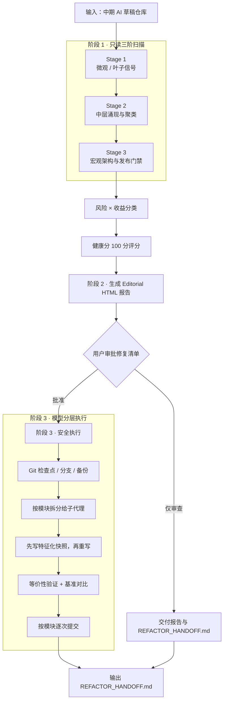

# 草稿到作品 · Draft-to-Opus

> 把 AI 写了一半的项目，审成能交付的工程。

[](https://docs.claude.com/en/docs/claude-code/skills)
[](#-三阶自底向上涌现扫描)
[](#-阶段-2-editorial-html-报告)
[](#-阶段-3-安全优先的模型分层执行)
[](LICENSE)

**Draft-to-Opus** 是一个面向「中期 AI 草稿项目」的审查与重构 Skill。它不重写你的业务，
而是在动任何一行代码之前，先用**自底向上的三阶扫描**把项目从散乱的补丁状态里读清楚，
产出一份低认知负荷的体检报告，再按**风险 × 收益**和**模型算力分层**安全地执行修复。

适用于：一个已经能跑、但结构开始失控的仓库 —— 重复的前端控件、越写越厚的 `utils`、
随手加的 `catch {}`、藏在循环里的 `O(n²)`、没人敢动的核心模块。

---

## 目录

- [为什么需要它](#-为什么需要它)
- [核心设计原则](#-核心设计原则)
- [整体工作流](#-整体工作流)
- [三阶自底向上涌现扫描](#-三阶自底向上涌现扫描)
  - [Stage 1 · 微观 / 叶子](#stage-1--微观--叶子单文件与单函数)
  - [Stage 2 · 中层涌现](#stage-2--中层涌现按目录与调用图聚合)
  - [Stage 3 · 宏观架构与发布就绪](#stage-3--宏观架构与发布就绪)
- [风险 × 收益矩阵与模型分层路由](#-风险--收益矩阵与模型分层路由)
- [健康分评分标准](#-健康分评分标准100-分)
- [阶段 2 · Editorial HTML 报告](#-阶段-2-editorial-html-报告)
- [阶段 3 · 安全优先的模型分层执行](#-阶段-3-安全优先的模型分层执行)
- [仓库结构](#-仓库结构)
- [安装](#-安装)
- [使用](#-使用)
- [REPORT_DATA 数据结构参考](#-report_data-数据结构参考)
- [术语表](#-术语表)
- [非目标](#-非目标)
- [常见问题](#-常见问题)
- [贡献](#-贡献)
- [许可](#-许可)

---

## 为什么需要它

AI 生成代码的典型形态不是「全错」，而是**「局部都对、全局失控」**：

| 现象 | 表面 | 真实代价 |
| :--- | :--- | :--- |
| 每个页面各自手写一套按钮 | 能点、能跑 | 改一处样式要改八个文件，令牌体系形同虚设 |
| 核心模块被反复热补丁 | 需求都满足了 | 没人说得清它当前的不变量，改一行怕崩三处 |
| `includes()` 写在循环里 | 数据量小时无感 | 上真实数据后从秒级退化到分钟级 |
| 空 `catch {}` 吞掉失败 | 日志很干净 | 故障以「偶发数据不对」的形式出现在线上 |
| 重试没有退避与预算 | 平时正常 | 下游抖动时被打穿，形成雪崩 |

这些问题的共同点是：**它们不会在单文件 review 里暴露**，必须跨文件、跨层地看。
Draft-to-Opus 就是为这个视角设计的 —— 从叶子证据出发，让宏观问题**自己浮现**，
而不是先套一个架构模板再去找证据。

---

## 核心设计原则

| 原则 | 含义 | 落地方式 |
| :--- | :--- | :--- |
| **证据优先** | 任何结论必须可定位 | 每条发现强制标注 `file:line`，禁止「大概在哪」 |
| **自底向上涌现** | 宏观问题从叶子证据聚合而来 | Stage 1 收集 → Stage 2 聚类 → Stage 3 综合，不做冗余全仓扫描 |
| **渐进披露** | 先给结论，细节按需展开 | 报告中分数、行动清单、模型路由默认可见；明细收进折叠抽屉 |
| **双模型分层** | 让对的算力做对的事 | 低风险 → 轻量模型；高风险高收益 → 高阶推理模型 |
| **安全第一** | 重构前先能回滚 | 干净 Git 状态 + 备份 + 独立分支 + 特征化快照，先锁行为再改结构 |
| **宁缺勿滥** | 明确的「不修」也是结论 | 高风险 × 中低收益项进入豁免区，阻止后续 AI 反复折腾 |

---

## 整体工作流



阶段 1 与阶段 2 **不修改任何源码**。写入只发生在用户批准之后，并且以模块为最小提交单元。

---

## 三阶自底向上涌现扫描

扫描方向是**自下而上**的：先在单文件/单函数层面收集具体证据，再按目录和调用图聚类，
最后在不重读原始文件的前提下综合出架构结论。这样每一步都建立在可引用的事实上，
而不是先有结论再找素材。

### Stage 1 · 微观 / 叶子（单文件与单函数）

1. **自动识别技术栈与基线**
   检查 manifest、配置文件与目录布局。若不存在可复用的前置模块，则提取草稿意图，
   仅在「非平凡」或「重复实现」的逻辑上匹配成熟库，避免为简单场景引入依赖。

2. **叶子代码信号采集**

| 层面 | 典型信号 | 判据 |
| :--- | :--- | :--- |
| **前端** | 裸 HTML 控件、硬编码颜色/间距/字号 | 是否已存在设计令牌却未使用 |
| | 重复的 `@keyframes` | 同名或等价动画在多处复制 |
| | 未节流的 `scroll` / `resize` | 高频事件直接绑定重计算 |
| | DOM 读写交错（layout thrashing） | 循环内读 `offsetHeight` 后立即写 `style` |
| | 未优化的大资源 | 未压缩图片、未做 tree-shaking 的打包产物 |
| **后端与数学** | 按 [perf-math-checklist](references/perf-math-checklist.md) 逐项走查 | 算法、数值、内存、I/O、并发、渲染、容错七类 |
| **卫生** | 静默 `catch {}`、硬编码密钥/路径/端口、不安全查询或路径拼接 | 失败被吞、注入面暴露 |

3. **性能与数学走查范围**
   见 [`references/perf-math-checklist.md`](references/perf-math-checklist.md)：
   二次/三次复杂度、ReDoS、浮点与 Kahan/Welford、时间与时区、编码越界、
   数据结构错配、DB 索引与 `OFFSET`、N+1、热路径克隆、跨 `await` 持锁等。

### Stage 2 · 中层涌现（按目录与调用图聚合）

Stage 1 的证据**按目录与调用图聚合**，不重新扫描源码，只做聚类与命名：

1. **前端 UI 大类归并**
   将控件归入六类 —— Selection / Input / Overlay / Navigation / Feedback / Data Display ——
   并判定每一类应「**仅统一令牌**」还是「**合并标准组件**」。
   执行 **Duplication Over Coupling**：结构重复可以合并，但**绝不跨业务域合并逻辑**。

2. **后端模块树与六大中等异味**
   为每个模块标注**血统**（`pro` / `semi` / `draft`）与**入度（fan-in）**：

   | 异味 | 识别特征 | 风险 |
   | :--- | :--- | :--- |
   | Scattered Functionality | 一个内聚流程被拆散到 4+ 个无关文件 | 改动遗漏、契约漂移 |
   | God Object | 单文件/类超过约 500–800 行，混合路由、校验、业务与存储 | 不可测、不可并行开发 |
   | Unstable / Hub Dependency | 稳定核心依赖易变边缘模块，或所有模块耦合到单一枢纽 | 单点故障、变更放大 |
   | Redundant Abstraction | 多层仅转发的包装，未隐藏任何变化 | 认知成本、断点噪声 |
   | Shared Mutable State | 通过隐藏全局可变状态通信，而非显式参数 | 时序 bug、测试不可复现 |
   | Data Clumps | 同一组 4+ 参数在多个函数间成组传递 | 契约分散、易漏改 |

3. **安全、数据与测试边界**
   见 [`references/full-spectrum-audit.md`](references/full-spectrum-audit.md)：
   IDOR / 越权、跨文件注入、幂等性、标志位汤 vs 状态机、原子事务、契约漂移、
   重复依赖库、只测happy path 或过度 mock 的测试。

4. **误报过滤**
   把「丑但稳定」「有意为之」的设计移入 **虽然丑但别乱动** 豁免清单 ——
   这是 Stage 2 最重要的减法。

### Stage 3 · 宏观架构与发布就绪

只使用 Stage 2 的边界信息综合，**不重新扫描原始文件**：

1. **分层秩序与抗风险三问**（用大白话回答，禁止术语堆砌）

| 问题 | 考察点 | 不达标的典型表现 |
| :--- | :--- | :--- |
| **关键处能否自愈** | 有界重试 + 抖动、熔断、状态恢复 | 失败即裸奔，重试无预算 |
| **能不能保证下线** | 舱壁隔离、缓存/降级兜底 | 依赖一个共享池，一处慢全站慢 |
| **极端情况是否会崩** | 空输入、超大载荷、竞态、超时、磁盘满 | 只在正常路径测过 |

2. **发布就绪门禁**

| 门禁 | 检查内容 |
| :--- | :--- |
| Accessibility & i18n | 键盘可达、焦点可见、可访问名称、文案是否硬编码 |
| Build / CI 可移植性 | 路径分隔符、大小写假设、平台相关命令 |
| Schema 迁移可逆性 | 是否可回滚、是否向后兼容 |
| FinOps | 付费/AI 接口是否有限流与缓存，避免无限额度消耗 |
| 可运维性文档 | `.env.example`、启动与排障 Runbook |

---

## 风险 × 收益矩阵与模型分层路由

每条发现都必须在 **Risk × Payoff** 上定档，并据此指定执行模型。这是整个 Skill 的调度核心：
**不是所有问题都值得修，更不是所有问题都值得用最贵的模型修。**

| 风险 \ 收益 | 高收益 | 中收益 | 低收益 |
| :--- | :--- | :--- | :--- |
| **高风险** | 🎯 **高阶推理模型执行**<br/>（先锁特征化快照） | ⛔ **豁免不修** | ⛔ **豁免不修** |
| **中风险** | 单文件 → 轻量模型<br/>跨文件/状态机 → 高阶模型 | 视范围路由 | ⛔ 豁免 |
| **低风险** | ✅ **轻量快速模型** | ✅ 轻量快速模型 | 视情况清理 |

### 模型分层责任表

| 档位 | 典型任务 | 推荐模型 | 前置条件 |
| :--- | :--- | :--- | :--- |
| **轻量快速** | 令牌清理、重复 `@keyframes`、死代码、`HashSet` 替换、空 `catch` 补日志、`.env.example` | Flash / Haiku / Mini | 单文件、行为不变、可快速 diff 审查 |
| **高阶推理** | 关键 `O(n²)` 或锁瓶颈、鉴权/IDOR 漏洞、核心自愈机制、跨文件状态机 | Opus / Pro / Reasoning | **重写前必须有严格的特征化快照** |
| **豁免** | 高风险 × 中低收益的一切 | —— | 写入豁免区，**禁止触碰** |

> 中风险项按作用域分流：**单文件**下沉到轻量模型，**跨文件或涉及状态机**上升至高阶模型。
> 判定标准是「一次改动能否在一个文件内闭合」。

---

## 健康分评分标准（100 分）

报告首页展示总分与分级结论。评分不是目的，而是让「现在能不能交付」有一个共同的锚点。

| 维度 | 权重 | 主要考察点 | 常见扣分源 |
| :--- | :---: | :--- | :--- |
| **UI 控件收敛度** | 15 | 六类控件的令牌统一与组件合并程度 | 各页面手写重复控件 |
| **非补丁与模块化** | 15 | 模块血统、内聚性、六大异味数量 | God Object、God utils、散点功能 |
| **性能与数学健康度** | 20 | 复杂度、数值稳定性、内存与 I/O | `O(n²)`、N+1、浮点货币、无界缓存 |
| **架构秩序与抗风险** | 20 | 分层纪律、自愈、降级、极端路径 | 跨层调用、无熔断、无超时 |
| **安全、数据完整性与可观测性** | 20 | 鉴权、注入、幂等、事务、日志与追踪 | IDOR、空 catch、无请求 ID |
| **发布就绪、依赖与可测性** | 10 | a11y/i18n、构建可移植、依赖收敛、测试质量 | 重复库、无锁文件、只测 happy path |

**参考分级**（用于填写 `verdict` 字段的示意口径，可按项目调整）：

| 分数区间 | 结论标签 | 建议动作 |
| :---: | :--- | :--- |
| 85–100 | 可交付 · 收尾 | 只做低风险清理 |
| 70–84 | 成长期 · 局部收敛 | 轻量模型清理 + 少量高阶重写 |
| 50–69 | 草稿态 · 先立骨架 | 先定边界与契约，再分批重构 |
| < 50 | 高风险 · 暂停扩功能 | 优先安全与正确性，冻结新特性 |

---

## 阶段 2 · Editorial HTML 报告

`assets/report-template.html` 是一个**单文件、零依赖、离线可开**的报告模板。
AI 只需要填充一个 `window.REPORT_DATA` 对象，模板负责全部渲染、动画和渐进披露。

### 报告结构（倒金字塔）

| 区块 | 内容 | 展现方式 |
| :---: | :--- | :--- |
| **Hero** | 总分环、一句人话总结、4 个 KPI、六维进度条 | 默认展开，首屏可见 |
| **行动清单** | 改造项、风险 × 收益、推荐模型、执行说明 | 主表格，默认可见 |
| **抽屉 01** | 架构分层、抗风险三问、发布门禁 | `<details>` 按需展开 |
| **抽屉 02** | 前端控件大类盘点（令牌 vs 组件） | `<details>` |
| **抽屉 03** | 后端模块血统树与中等异味 | `<details>`，可折叠树 |
| **抽屉 04** | 性能热点、数学损失与资源浪费 | `<details>` |
| **抽屉 05** | 安全边界、状态机、可观测性与豁免区 | `<details>`，含「虽然丑但别乱动」清单 |

### 写作纪律

- 每个单元格**只写一句**短白话，**零术语泄漏**。
- 位置统一使用 `file:line`，放在等宽字体中。
- 结论先行：先给「修不修、谁来修」，再给「为什么」。
- 报告是**只读产物**：它描述现状与建议，不代表已经修改。

---

## 阶段 3 · 安全优先的模型分层执行

只有当用户批准修复清单后，才进入写入阶段。顺序不可颠倒：

```text
① Git 安全检查点 ──▶ ② 模块化拆分 ──▶ ③ 特征化锁定 ──▶ ④ 等价验证 ──▶ ⑤ 逐模块提交 ──▶ ⑥ Handoff
```

| 步骤 | 要求 | 失败处理 |
| :---: | :--- | :--- |
| ① | 确认 `git status` 干净；创建专用分支或 tag；保存完整备份 | 不干净则先让用户决定暂存/提交/丢弃 |
| ② | 按模块或「批次」拆分，每个子代理只负责一个模块，并匹配其模型档位 | 范围过大则继续拆分 |
| ③ | 重写**之前**，把可观察输入/输出冻结为测试或快照 | 无法冻结则该模块不进入重写 |
| ④ | 验证行为等价，并对热点跑基准对比 | 不等价则回滚该模块，不放宽断言 |
| ⑤ | 每个模块一次提交，提交信息说明模块与验证结果 | 失败批次单独回滚，不牵连已完成批次 |
| ⑥ | 按 `references/handoff-template.md` 输出 `REFACTOR_HANDOFF.md` | —— |

### REFACTOR_HANDOFF.md 的作用

它是给**下一个 AI 或开发者**的说明书：包含回滚锚点、每个模块的前后对比、
所锁定的外部契约、验证结果，以及出问题时「只针对锁定契约做小修」的指引 ——
从机制上阻止下一轮修复重新引入全局补丁。

---

## 仓库结构

```text
draft-to-opus/
├── SKILL.md                          # 技能入口：完整阶段、评分、路由规则
├── README.md                         # 本文件
├── assets/
│   └── report-template.html          # 单文件 Editorial 报告模板（填充 REPORT_DATA）
└── references/
    ├── perf-math-checklist.md        # 性能、数学、内存、I/O、并发、渲染、容错清单
    ├── full-spectrum-audit.md        # 六大异味、安全、数据、可观测、发布就绪清单
    └── handoff-template.md           # REFACTOR_HANDOFF.md 模板
```

| 文件 | 何时被读取 |
| :--- | :--- |
| `SKILL.md` | 技能被触发时，作为唯一入口 |
| `references/perf-math-checklist.md` | Stage 1 后端与数学走查 |
| `references/full-spectrum-audit.md` | Stage 2 安全 / 数据 / 测试边界 |
| `assets/report-template.html` | 阶段 2 生成报告 |
| `references/handoff-template.md` | 阶段 3 交付时 |

---

## 安装

Claude Code 会在用户级 skills 目录中发现该技能：

```powershell
git clone https://github.com/HIMKUG/draft-to-opus.git "$env:USERPROFILE\.claude\skills\draft-to-opus"
```

目录结构需保持 `SKILL.md` 位于技能根目录。安装后重启会话即可被识别。

---

## 使用

技能通过 `description` 中的触发语自动匹配，也可以显式调用：

```text
/draft-to-opus
```

或直接用自然语言说明意图：

```text
帮我对这个仓库做一次「草稿到作品」三阶审查，先只出报告，不要改代码。
```

典型对话节奏：

| 你想要的 | 你可以说 |
| :--- | :--- |
| 只要体检 | 「先只读审查，出 HTML 报告」 |
| 分批修 | 「只执行低风险那批」 |
| 重写核心模块 | 「先锁特征化快照，再重写这个模块」 |
| 追查回归 | 「把这个 Handoff 交给下一个 AI 定位」 |

---

## REPORT_DATA 数据结构参考

模板唯一需要填充的对象。字段均以报告模板中的实际字段名为准。

| 字段 | 类型 | 必填 | 说明 |
| :--- | :--- | :---: | :--- |
| `projectName` | `string` | ✓ | 项目名，显示在标题与页面标题中 |
| `scanDate` | `string` | ✓ | 扫描日期（`YYYY-MM-DD`） |
| `totalScore` | `number` | ✓ | 0–100 总分，驱动圆环动画与计数 |
| `verdict` | `string` | ✓ | 分级结论，如「成长期 · 局部收敛」 |
| `plainSummary` | `string` | ✓ | 一句大白话总结，首屏展示 |
| `kpis[]` | `{ val, lbl }` | ✓ | 四个关键数字，如「6 项 / 建议修复」 |
| `dimensions[]` | `{ name, score, max }` | ✓ | 六维得分，渲染为进度条 |
| `actions[]` | `{ name, riskPayoff, model, desc }` | ✓ | 行动清单；`model` 取 `fast` 或 `opus` |
| `archLayers[]` | `{ title, items[], note }` | ○ | 架构分层栈 |
| `resilience[]` | `{ title, body }` | ○ | 抗风险三问卡片 |
| `frontendInventory[]` | `{ category, variants, action, note }` | ○ | 前端控件盘点表 |
| `backendTree` | 递归节点 `{ name, provenance, desc, children[] }` | ○ | 模块树；`provenance` 取 `pro` / `semi` / `draft` |
| `perfLosses[]` | `{ category, location, issue, fix, impact }` | ○ | 性能与数学损失表 |
| `deepAudit[]` | `{ domain, location, issue, fix, impact }` | ○ | 安全与数据审查表 |
| `exemptions[]` | `string[]` | ○ | 「虽然丑但别乱动」豁免清单 |

> 渲染端另有 `provMap` 与 `modelMap` 两个固定映射：
> `pro / semi / draft` 对应「专业 / 半手写 / 手写草稿」，
> `fast / opus` 对应「轻量快速模型 / 高阶推理模型」。填充时只写键值，不写文案。

---

## 术语表

| 术语 | 定义 |
| :--- | :--- |
| **血统（provenance）** | 模块来源标记：`pro` 可复用、`semi` 带补丁、`draft` 建议重写 |
| **入度（fan-in）** | 有多少其他模块依赖该模块；高入度意味着改动影响面大 |
| **涌现（emergence）** | 不预设架构模板，让中层与宏观结论从叶子证据中聚合出来 |
| **特征化（characterization）** | 在重写前用测试/快照固定现有可观察行为，作为等价性基准 |
| **豁免区** | 明确判定「不修」的高风险低收益项，用于阻止后续反复折腾 |
| **Duplication Over Coupling** | 宁可保留结构重复，也不跨业务域强行合并逻辑 |
| **轻量快速模型 / 高阶推理模型** | 按任务风险与作用域划分的两档执行算力 |

---

## 非目标

- **不做全仓平均主义扫描**：只沿证据路径展开，避免为了覆盖而覆盖。
- **不替代测试与 CI**：审查给出风险判断，最终正确性仍由项目自身的验证链保证。
- **不追求「一次重构到位」**：以模块为最小可回滚单元，逐批交付。
- **不为丑而改**：稳定但有意的设计进入豁免区，而不是进入待办列表。
- **不引入未经用户同意的依赖**：新增公共库需先给选项与取舍。

---

## 常见问题

**Q：它和普通 `/code-review` 有什么区别？**
普通 review 面向一次 diff；Draft-to-Opus 面向**整个中期仓库的健康度**，并且包含分层扫描、
评分、模型路由与安全执行流程，关注的是「现在能不能交付、下一步谁来修」。

**Q：会直接改我的代码吗？**
阶段 1 与阶段 2 全程只读。只有在你批准修复清单后，阶段 3 才会写入，并且必须先建立
Git 检查点与特征化快照。

**Q：为什么高风险项反而可能「不修」？**
因为收益不足以覆盖风险。把这类项写进豁免区，比反复半途重构更能保护项目。

**Q：报告可以在离线环境打开吗？**
可以。模板是单文件 HTML，样式与脚本全部内联，无外部请求。

---

## 贡献

欢迎提交针对检查清单的补充、误报案例和真实项目中的反例：

1. Fork 仓库并新建分支。
2. 对 `references/` 中清单的修改，请附上**可复现的代码片段**与 `file:line` 式的判据。
3. 对报告模板的修改，保持单文件、零外部依赖、渐进披露结构不变。
4. 提交 Pull Request，并说明该改动会改变哪一类判定。

---

## 许可

本项目基于 [MIT License](LICENSE) 发布。

---

<p align="center">
  <sub>先看清楚，再动手。 — Draft-to-Opus</sub>
</p>
